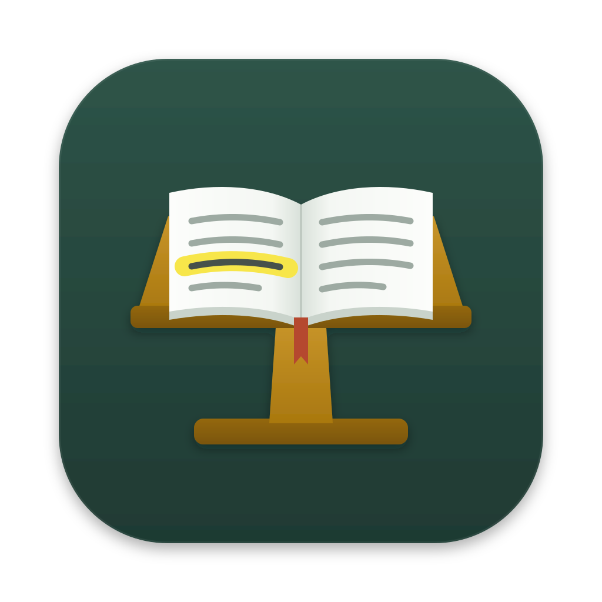

# Lectern



Ask a research question in plain words. Lectern searches academic paper databases, reads the
abstracts, and writes an answer where every citation links to a real paper you can open and check.

It runs on your Mac or Windows PC. Your conversations and saved papers stay on your computer.

## What you need

- A Mac with Apple Silicon (M1 or newer) running macOS 13 Ventura or later, **or** a Windows 10/11 PC (64-bit).
- A **Claude** or **ChatGPT** plan, signed in on this computer through **Claude Code** or **Codex**
  (either on its own, or inside the Claude or ChatGPT desktop app). Lectern uses that sign-in,
  so there is no API key to buy or paste. Questions count against that plan.

## Install on a Mac

1. Open the [latest release](../../releases/latest) and download **Lectern-0.2.0.dmg**.
2. Open the downloaded file and drag **Lectern** onto **Applications**.
3. Open Lectern from Applications. The first time, macOS says it cannot check the app for
   malicious software. Click **Done**, then open **System Settings > Privacy & Security**, scroll
   down, and click **Open Anyway** next to Lectern. You only do this once.

   This happens because Lectern is a free app that is not registered with Apple. You can read
   all of its code in this repository.

## Install on Windows

1. From the [latest release](../../releases/latest), download **Lectern-0.2.0-windows-x64.zip**.
2. Right-click the file, choose **Extract All**, and put the **Lectern** folder somewhere that suits you
   (for example your Documents folder).
3. Open the folder and double-click **Lectern.exe**. The first time, Windows SmartScreen may say it
   protected your PC: click **More info**, then **Run anyway**. You only do this once.

   This happens because Lectern is a free app without a paid code-signing certificate. The Windows build
   is built on a Mac and has not yet been tested on a Windows PC; please report anything that does not work.
4. Install **Claude Code** (`irm https://claude.ai/install.ps1 | iex` in PowerShell, then run `claude` once to
   sign in) or **Codex** (`npm install -g @openai/codex`, then `codex login`).
5. For voice input on Windows, click in the question box and press **Windows key + H**.

## First run

1. Lectern asks what you study (level and field). Pick both, or skip. Answers are pitched to match.
2. Lectern finds Claude Code or Codex by itself. If it says **Not signed in**, open Terminal, run
   `claude` (or `codex login`), sign in, then click **I have signed in** in Lectern.
3. Optional but recommended: get a free key from [OpenAlex](https://openalex.org/settings/api),
   the largest paper database, and paste it into **Settings > Paper databases**.

Then type a question, for example *Does remote work improve employee productivity?*, and press Enter.

**Download PDF** under an answer saves the whole answer as a PDF: the question, the answer with its citations, any figures, each paper's findings, the reference list in your chosen style, and every paper's abstract.

## Voice input

In the Mac app, click the mic beside the question box. On first use, allow **Lectern Voice**
to access Microphone and Speech Recognition. If access was denied, enable it in System Settings →
Privacy & Security. The sound bars appear only after the microphone starts. Click again or press
Escape to stop. Speech is inserted at the cursor; selected text is replaced. Editing, sending, or
leaving the composer stops voice input.

Recognition uses Apple's Speech framework, on this Mac when the language supports it and Apple's
service otherwise. Audio is not saved, and voice input does not consume Claude or ChatGPT credits.
Sessions end after two minutes. Browser mode uses the browser's speech service; Windows uses Win+H.
Development builds need Apple's Command Line Tools to compile the small native helper on first use.
Packaged Mac builds include it and do not need a compiler.

## Writing desk

Open **Writing desk** in the sidebar (Cmd+K on a Mac, Ctrl+K on Windows) for four separate tools.

**Proofread** marks spelling, grammar, punctuation, capital-letter and spacing mistakes in your text and lists a
suggestion for each, which you accept or dismiss (Cmd/Ctrl+Z undoes an accepted change). Common misspellings,
repeated words, "a" and "an", spacing and a lower-case "i" are marked as you type, on your computer, without using
your plan. Press **Check** to have your selected model read every sentence; checking again sends only the sentences
you changed. Choose American, British, Australian or Canadian English, or leave it on Any English to keep your own
spelling. Quotations, citations, links and code are never changed. Tested on 300 held-out sentences of public web
text (CWEB) with Claude Opus 5.5, 63% of the model's changes matched a human editor's correction and it changed 3% of
the sentences the editors left alone; it found 41% of the editors' corrections. It misses mistakes and some
suggestions are wrong, so read each one before you accept it. Method and numbers: `bench/grammar/README.md`.

**AI writing** highlights writing patterns
and gives sentence-level reasons and writing suggestions. Its experimental score is not a validated
probability of AI authorship. Select a connected review model above the text box; the initial
selection is GPT-6.1 Sol, and the choice is remembered. **Plagiarism / similarity** compares passages against paper abstracts,
your saved Library and readable public web pages, then shows source links and matching excerpts.
A similarity match needs citation review; it is not itself a finding of plagiarism. **Rewrite** rephrases a passage of up to 12,000 characters for clarity and natural expression. Compare it with the original, verify its facts and citations, and keep attribution for borrowed ideas. Rewriting does not guarantee a lower score. You can send the editable rewrite to either check.

Paste text or upload/drop a PDF with a text layer, Word (.docx), OpenDocument (.odt), RTF, HTML,
Markdown or text file, up to 12 MB. Scanned PDFs need OCR first. Checks cover at most the first
20,000 words and report when text was shortened. Documents are not saved by Lectern. Model review
sends text to your selected provider, and similarity searches send distinctive passages to the
selected databases and web search. Neither tool has access to Turnitin's private submission index.

**Quote and cite matches** on a similarity report puts every passage that matches a source word for word in
quotation marks, adds an author-date citation built from the matched source's own record, cites close paraphrases at
the end of their sentence, adds the sources to your reference list, and checks the text again. Your own words are not
changed. Check each citation against the source before you submit.

**Rewrite** checks its own answer: every number, name, acronym, quotation and citation in your text must still be
there, and nothing new may be added. If the first attempt changes a fact, it is redone once; if the second still
does, Lectern shows exactly what changed instead of hiding it. Rewriting is for clearer writing. It is not a way to
hide AI-written or copied text, and it does not promise a lower score.

The AI writing report also shows a **style model**: a second reading from a small model trained on public labelled
human and AI texts and tested on a fresh set of 2024-25 models (AUROC 0.88). It is not part of the score, and the
report states where it is weak, including that it wrongly flags more essays by non-native English writers.
Details: `bench/results/style-v2-v3.md`.

**Export PDF** on a finished AI writing or similarity report saves the whole report as a PDF: the score, your
text with its highlights, every flagged sentence or matching source with its excerpts, and what was searched. In the
desktop app it asks where to save the file; in a browser it opens the print dialog, where you choose Save as PDF.

## Good to know

- The two rings beside the model name show **Claude** and **GPT / Codex** plan usage. The larger
  arc is weekly usage; the smaller arc is five-hour usage. Empty means 0% used, full means 100%.
  Click a ring for percentages and reset times. Readings refresh every two minutes while the
  window is visible; dashed arcs mean a reading is unavailable. To show the Claude ring, Lectern reads
  Claude Code's saved sign-in on this computer and asks Anthropic for your plan usage; the sign-in is
  sent only to Anthropic. The GPT ring asks the Codex tool itself.
- Lectern reads **abstracts, not full papers**. Open the papers you plan to cite.
- Reference details come from the databases, which contain mistakes. Check author names and page
  numbers before you submit.
- **Cite** on any paper gives APA 7, Harvard, MLA 9, AGLC4, BibTeX or RIS. **Library** keeps the
  papers you save, the chats you save (press **Save chat** at the top of a conversation, or the bookmark in the sidebar) and single questions (hover a question and press **Save**); export papers to Zotero, Mendeley or EndNote.
- Follow your course's rules on using AI tools.

## If something goes wrong

| What you see | What to do |
|---|---|
| "Lectern cannot be opened" or "not verified" | Install step 3 |
| "Lectern is damaged" | Run `xattr -dr com.apple.quarantine /Applications/Lectern.app` in Terminal, then open it again. Only do this for a copy you downloaded from this page |
| "Not installed" in Settings | Install Claude Code or Codex, or the Claude or ChatGPT desktop app |
| "Not signed in" | Run `claude` or `codex login` in Terminal and sign in |
| OpenAlex "needs a free API key" | First run step 3 |
| Semantic Scholar "is busy" | Normal without a key; the other databases still answer |

To reset Lectern, delete the folder `~/Library/Application Support/Lectern` (Mac) or `%APPDATA%\Lectern` (Windows).

## For developers

Needs Node.js 20 or newer.

```
npm install
npm start          # run the desktop app
npm run web        # or run it in your browser at http://127.0.0.1:4319
npm test           # offline tests
npm run make-app   # build dist/Lectern-darwin-arm64/Lectern.app
```

No runtime dependencies: the server uses Node built-ins only, and the window is plain HTML,
CSS and JavaScript with no build step. `CLAUDE.md` explains how the code fits together.
